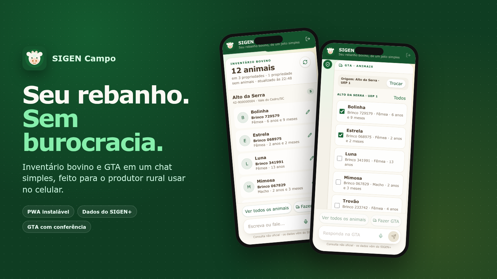
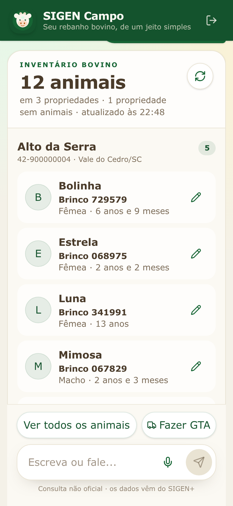
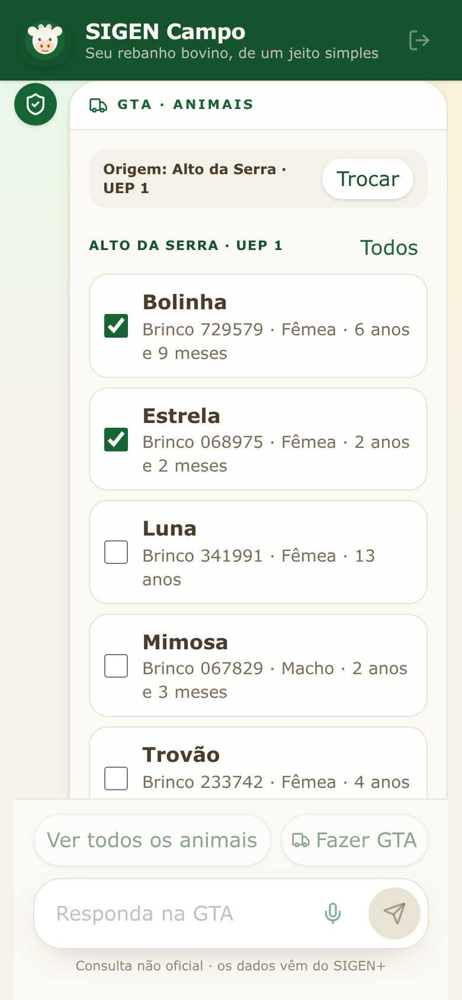
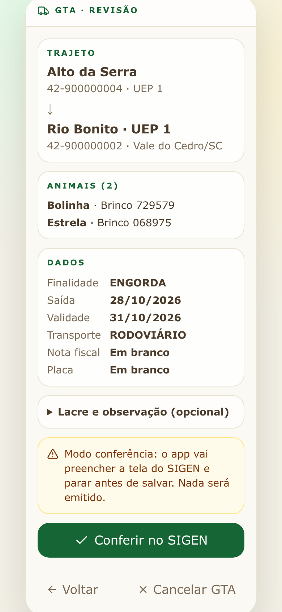
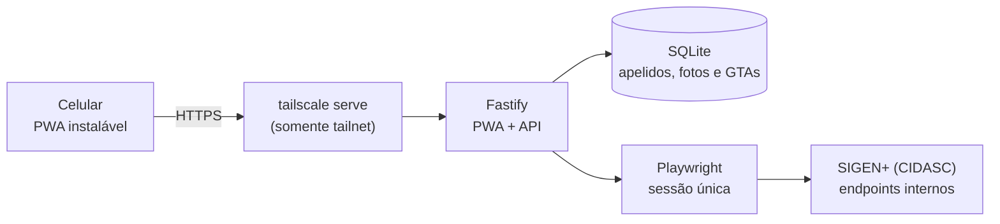

<p align="center">
  
</p>

<h1 align="center">SIGEN Campo</h1>

<p align="center">
  O rebanho bovino do <strong>SIGEN+ (CIDASC/SC)</strong> e a emissão de GTA<br>
  em um chat simples, feito para quem usa o celular no dia a dia.
</p>

<p align="center">
  <a href="https://github.com/giuliovalcanaia/controle-sigen/actions/workflows/ci.yml"></a>
  
  
  
  
  
</p>

> [!NOTE]
> **Projeto independente, não oficial.** O SIGEN Campo não é mantido pela CIDASC e não substitui o SIGEN+. Ele lê os dados da conta do próprio produtor e, quando habilitado, preenche a tela oficial da GTA com conferência antes de salvar.

## O problema

O SIGEN+ concentra a defesa agropecuária de Santa Catarina, mas o produtor que só quer ver o rebanho ou tirar uma GTA encontra uma interface pensada para o balcão do escritório: muitos campos, nomes técnicos e relatórios em PDF.

O SIGEN Campo traduz esse fluxo para uma conversa. Ele mostra **todos os bovinos das propriedades**, com o número que o produtor realmente usa no dia a dia, e conduz a GTA em etapas — sem esconder que a GTA é um documento oficial.

## O que ele faz

- **Inventário em uma tela:** todos os bovinos, agrupados por propriedade/UEP, com **brinco de manejo**, apelido e foto.
- **Apelidos e fotos locais:** o produtor nomeia cada animal e tira uma foto. A imagem é recortada e reduzida para 512×512 **no navegador**, sem EXIF, e fica só no servidor da instalação.
- **GTA em conversa:** animais → CPF/CNPJ do destino → UEP → finalidade e datas → revisão → emissão ou conferência.
- **Modo conferência:** com a emissão desligada, o app preenche a tela oficial do SIGEN e **para antes de salvar**. Nada é emitido.
- **PWA instalável:** pensado para 390 px, com área segura de teclado e instalação na tela inicial.

## Telas

<table>
  <tr>
    <td width="33%" valign="top"></td>
    <td width="33%" valign="top"></td>
    <td width="33%" valign="top"></td>
  </tr>
  <tr>
    <td align="center"><sub>Inventário com apelidos</sub></td>
    <td align="center"><sub>Seleção dos animais</sub></td>
    <td align="center"><sub>Revisão da GTA</sub></td>
  </tr>
</table>

> As imagens acima saem do modo mock, com fixtures anonimizadas. Nenhum dado de produtor real aparece nelas.

## Destaques de engenharia

- **Parser de PDF que falha em vez de mentir.** O relatório do SIGEN é lido com `pdftotext -layout`; a quantidade de linhas é conferida contra `Qtde. Animais`. Se o layout mudar, o app lança `PDF_LAYOUT_MUDOU` e não devolve dados parciais.
- **Uma sessão, um navegador.** O SIGEN derruba a sessão anterior quando outro login acontece. O app mantém um único `BrowserContext`, um mutex global e encerra por **20 minutos de ociosidade** — não por tempo total.
- **Leitura por JSON, não por scraping.** Depois do login, o Playwright usa `context.request` contra os endpoints internos do SIGEN. A UI oficial só é usada para a GTA, que é uma tela ExtJS dentro de um iframe.
- **GTA com reserva atômica.** A viagem (origem + animais + data) é reservada no SQLite antes de abrir o navegador. A mesma viagem não pode ser emitida duas vezes; se o `Add` responder de forma ambígua, o estado vira **incerta** e bloqueia até o produtor conferir no SIGEN.
- **Privacidade por desenho.** CPF de terceiro é usado só para buscar a UEP, nunca é gravado e aparece mascarado. PDFs de GTA ficam com permissão `600` e `Cache-Control: no-store`. Não existe cache de animais: o SIGEN é a fonte da verdade.
- **Contratos compartilhados.** API e PWA usam o mesmo pacote `@sigen/contracts` para tipos, datas e máscaras, evitando divergência entre servidor e interface.

## Como funciona



- O login acontece **sob demanda**, na primeira consulta.
- O PDF de cada UEP é baixado, convertido em texto e validado fora do mutex da sessão.
- A emissão da GTA é **desligada por padrão** (`GTA_EMISSAO_ATIVA=0`). Só depois de uma emissão real validada ela é habilitada no servidor.

## Stack

| Camada | Tecnologias |
|---|---|
| PWA | React 19, Vite 8, Tailwind CSS 4, `vite-plugin-pwa` |
| API | Node.js 22, Fastify 5, Zod 4, `better-sqlite3` |
| Automação | Playwright (Chromium), `context.request` e driver da tela ExtJS |
| Contratos | TypeScript workspaces (`@sigen/contracts`) |
| Testes | Vitest, 148 testes entre API e PWA |
| Infra | Docker Compose, `tailscale serve`, `poppler-utils` |

## Rodando em 2 minutos

Sem credenciais do SIGEN: o modo mock usa as fixtures anonimizadas.

```bash
npm install
SIGEN_MOCK=1 npm run dev
```

Abra **http://127.0.0.1:5173**. A API sobe em `http://127.0.0.1:3000` e o Vite faz proxy de `/api`.

> Requisitos: Node.js 22.12+ e `poppler-utils` (`pdftotext`) para ler PDFs reais. O Chromium do Playwright só é necessário para falar com o SIGEN: `npx playwright install chromium`.

### Com o SIGEN real

```bash
cp .env.example .env
npm run sigen:login   # abre o Chromium; salva só os cookies em .auth/
npm run sigen:check   # valida a leitura do inventário
npm run dev
```

A senha nunca é digitada no código nem no app: o login é feito na tela oficial e a sessão fica no servidor. O passo a passo completo está em [`docs/operacao.md`](docs/operacao.md).

## Scripts

| Comando | O que faz |
|---|---|
| `npm run dev` | API + PWA em desenvolvimento |
| `SIGEN_MOCK=1 npm run dev` | Interface com dados de demonstração, sem credenciais |
| `npm test` | Vitest da API e do PWA |
| `npm run typecheck` | TypeScript dos dois workspaces |
| `npm run build` | Compila contratos, API e PWA |
| `npm start` | Produção: o Fastify serve o PWA e a API |
| `npm run sigen:login` | Login manual no SIGEN, sem senha no código |
| `npm run sigen:check` | Confere o inventário real (somente leitura) |
| `npm run sigen:gta:check` | Confere a tela de GTA (somente leitura) |
| `npm run screenshots` | Gera as imagens deste README no modo mock |
| `npm run deploy` | Publica o que está commitado (veja [`docs/operacao.md`](docs/operacao.md)) |

## Testes e CI

```bash
npm test
npm run typecheck
```

O workflow em [`.github/workflows/ci.yml`](.github/workflows/ci.yml) roda `typecheck`, testes e build em cada push para `master` e em pull requests. Os testes cobrem o parser de PDF, o agrupamento do inventário, a política de emissão, a reserva da viagem, os contratos e as regras da conversa de GTA.

## Estrutura

```text
apps/api/
  src/sigen/          sessão Playwright, cliente, parser de PDF e driver da GTA
  src/gta/            serviço, política de emissão, runner, schema e mock
  src/inventory.ts    job do inventário (coalescido, sem cache)
  src/db.ts           SQLite (apelidos, fotos e histórico de GTAs)
  src/routes.ts       API REST
apps/web/             PWA React + Vite + Tailwind
  src/gtaFlow.ts      regras da conversa de GTA (fases, voltar, validação)
  src/components/     chat, inventário e cartões da GTA
packages/contracts/   tipos, datas e máscaras compartilhados
fixtures/inventory/   fixtures anonimizadas usadas nos testes e no mock
docs/                 fluxo técnico da GTA, operação e imagens
```

## Segurança e privacidade

- **A GTA é um documento oficial.** Depois do `POST /SaidaAnimais/Add`, o app nunca repete o salvamento sozinho. Resposta ambígua vira **incerta** e o produtor confere no SIGEN.
- **Emissão desligada por padrão.** `GTA_EMISSAO_ATIVA=0` só confere a tela; `1` é habilitado no servidor depois de uma emissão real validada.
- **CPF não vaza.** O CPF do produtor vem da sessão e fica no servidor. O CPF de terceiro é usado só para buscar a UEP e emitir, não é gravado e aparece mascarado no histórico e nos erros.
- **Fotos são dados locais.** Ficam em `data/fotos/<brinco oficial>.jpg`, já sem metadados, e nunca são enviadas ao SIGEN.
- **PDFs de GTA são privados.** Ficam em `data/gta`, com permissão `600`, fora do git e servidos com `no-store`.
- **Fixtures e imagens sem PII.** As fixtures versionadas usam códigos, localidades e brincos fictícios. As capturas do README saem do mock, em um banco temporário.

## Documentação

- [`docs/gta-fluxo.md`](docs/gta-fluxo.md) — mapa técnico da tela de GTA do SIGEN.
- [`docs/operacao.md`](docs/operacao.md) — desenvolvimento, produção, Docker, Tailscale e problemas comuns.
- [`GLOSSARY.md`](GLOSSARY.md) — vocabulário do domínio (manejo, brinco oficial, UEP, viagem, incerta).
- [`AGENTS.md`](AGENTS.md) — convenções para agentes e contribuições automatizadas.

## Licença

[MIT](LICENSE). O SIGEN Campo é um projeto independente e não oficial, sem vínculo com a CIDASC. Use por sua conta e risco: a conferência no SIGEN continua sendo a fonte da verdade.
